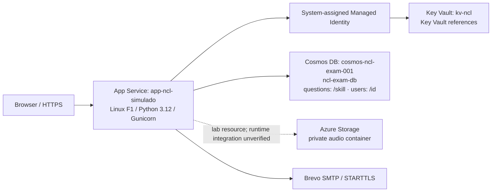

# Chemin des Étoiles 🌟

**Learn beginner French through a fantasy adventure—and explore the Azure infrastructure behind it.**

Chemin des Étoiles (`ncl-simulado`) is a Flask application combining gamified French A1 practice with unofficial TEF Canada / TCF Canada practice exams. Built for a small private test group of approximately three people, it also serves as an **AZ-104 hands-on administration lab**: deploy, secure, diagnose, and maintain a real workload on Azure.

**[Live demo](https://app-ncl-simulado-d2dgdvhkcphcekhp.canadaeast-01.azurewebsites.net)** · [Azure deployment](docs/azure/README.md) · [Incident lessons](docs/azure/troubleshooting.md) · [AZ-104 skills map](docs/azure/az104-skills-map.md)

> This is a learning project, not an official examination platform or a certification of French proficiency. The Free F1 hosting tier can sleep, cold-start, or hit quotas; availability is not guaranteed. The live site is a test environment: use a unique password and avoid sensitive data.

## What you can do

- Create an email-confirmed account, select a hero, and save progress.
- Explore **40 A1 stages** across three internal areas of world map 1, **Hameau des Érables**: village, road/forest, and castle/city. These are not three complete world maps.
- Practice through voice battles, block-based sentence missions, conversations, stories, cards, and library activities. Browser speech support and microphone permissions vary.
- Face area-ending battles and the **stage 40 castle boss**.
- Earn **640 XP** across the first map's stage rewards; advance levels to unlock frames. Frames are earned, not purchased.
- Earn crystals and customize through the shop: palettes, particles, French titles, pets, and scenes. Owned pets can be renamed for free.
- Access unofficial **TEF/TCF Canada practice exams**, including timed practice and account-based history.

A1 describes the scope of the current learning content, not a guarantee that completing one map covers the entire CEFR level. Practice scores are not official TEF/TCF results.

## Technology

| Layer | Implementation |
|---|---|
| Application | Python 3.12 target, Flask, Jinja templates, JavaScript, CSS, JSON content |
| Server | Gunicorn on Azure App Service, Linux Free F1 |
| Persistence | Azure Cosmos DB for NoSQL; `azure-cosmos` SDK |
| Configuration | Environment variables; `python-dotenv` locally |
| Secrets | Azure Key Vault references resolved with system-assigned managed identity |
| Email | Brevo SMTP with STARTTLS |
| Audio | Static game audio; private Azure Storage audio resource in the lab inventory |

The checked-in requirements are not version-pinned. Dependency pinning and reproducible builds are follow-up work.

## Architecture



Managed identity authorizes **Key Vault secret retrieval**, not direct Cosmos DB access. The current Cosmos SDK still authenticates using the connection string supplied by Key Vault. The Flask source does not currently demonstrate Blob SDK access; Storage is documented as a lab resource, not a verified live audio delivery path. Static audio is included in the app assets.

## Screenshots

Screenshots will be added after removing personal data, account identifiers, tokens, and secret values.

| Planned capture | Purpose |
|---|---|
| World map and stage 40 | Learning journey and final boss |
| Hero and shop | Progression and customization |
| TEF/TCF practice | Timed exam interface |
| Azure resource overview | Infrastructure inventory |
| Resolved Key Vault references | Secret configuration, with values hidden |

## Run locally

Use Python 3.12 and a separate virtual environment. From the project root:

```bash
python -m venv .venv
# Linux/macOS
source .venv/bin/activate
# Windows PowerShell instead: .\.venv\Scripts\Activate.ps1
python -m pip install -r requirements.txt
```

Copy `.env.example` to `.env` locally, then replace placeholders privately. Do not commit or upload `.env`. The configuration names are:

```text
COSMOS_CONNECTION
STORAGE_CONNECTION
SECRET_KEY
MAIL_SERVER
MAIL_PORT
MAIL_USE_TLS
MAIL_USERNAME
MAIL_FROM
MAIL_PASSWORD
APP_BASE_URL
SCM_DO_BUILD_DURING_DEPLOYMENT
NCL_USUARIOS_TESTE
NCL_SENHA_TESTE
NCL_MODO_TESTE
```

Cosmos must have database `ncl-exam-db`, container `questions` partitioned by `/skill`, and container `users` partitioned by `/id`. Provisioning containers does not seed questions. Local dotenv values must be actual local configuration, not App Service Key Vault reference expressions.

```bash
flask --app app run
```

Open the local address printed by Flask. Gunicorn is for Linux deployment, not native Windows. Never expose Flask's development server publicly.

**Security before testing:** set a strong, stable `SECRET_KEY`. The source has a development fallback and a special `teste` user; explicitly disable the special user with an empty `NCL_USUARIOS_TESTE` or protect it with `NCL_SENHA_TESTE`. Deleting the setting restores the default test username. `NCL_MODO_TESTE=0` alone does not disable it. Without SMTP configuration, confirmation links are written to logs rather than emailed; treat these logs as sensitive.

## Deploy to Azure

The lab uses `rg-ncl-simulado-dev` in **Canada East**, App Service `app-ncl-simulado`, Key Vault `kv-ncl`, and Cosmos account `cosmos-ncl-exam-001`.

1. Confirm the Linux F1 plan and supported Python runtime.
2. Configure Cosmos containers, private Storage, and Key Vault secrets.
3. Enable the app's managed identity and grant **Key Vault Secrets User**.
4. Configure reference-based app settings, Gunicorn startup, and remote build.
5. Package without local secrets/environments; ZIP-deploy and validate HTTPS, persistence, and email delivery.

Follow the [deployment guide](docs/azure/README.md). Nothing in this documentation automatically deploys resources. F1 only covers App Service compute; other resources and restore operations may incur charges.

## Roadmap — planned, not implemented

Based on the existing [curriculum plan](docs/plano-mapas-seguintes.md):

- **Map 2 — Forêt Rousse:** expand A1 themes and introduce carefully supported bridges toward A2.
- **Map 3 — Bourg du Carrefour:** transition from A1 toward A2 with daily-life scenarios and guided messages.
- **Maps 4–6:** Lac d'Argent, Château Royal, Citadelle de l'Ouest—develop and consolidate A2; B1 progression depends on demonstrated readiness.
- **Maps 7–10:** Monts Givrés, Pics du Nord, Abbaye des Brumes, Tours de l'Aube—conditional B1 development and more autonomous practice.
- **Maps 11–12:** Phare du Ponant, Port des Voiles—curriculum still to validate, with targeted TEF/TCF preparation. No automatic B2 claim.
- Infrastructure follow-ups: dependency pinning, infrastructure as code, CI/CD with OIDC, restore drills, and deeper monitoring.

Future maps are design work, not playable content. XP and time spent are not language-proficiency certifications. Some historical design documents are in Portuguese; this GitHub overview and the Azure documentation are in English.

## Author

**Rokay Lancaster** — building practical cloud administration experience while creating tools for language learning.

[GitHub](https://github.com/rocaster) · [Portfolio — rokay.dev](https://rokay.dev) · [LinkedIn](https://www.linkedin.com/in/alex-costa-2232b434b/)
